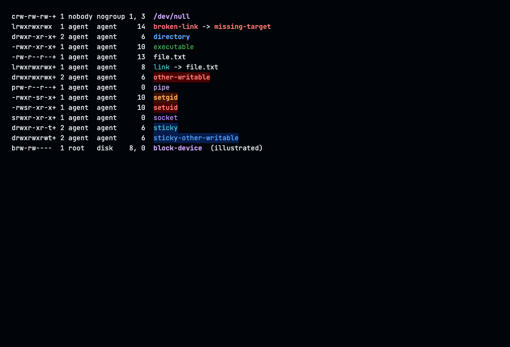

# Default configuration

Agentainer seeds these files into a new home and leaves existing files unchanged. They live in `rootfs/etc/agentainer/home/` in the repository and `/etc/agentainer/home/` in the image. The shared instructions come from `rootfs/etc/agentainer/AGENTS.md`. The startup step is [`20-seed.sh`](../rootfs/usr/local/lib/agentainer/entrypoint.d/20-seed.sh).

No default contains an account, token, private endpoint or signing key. The Git identity and signing examples are comments. Runtime environment variables can still supply Git identity and enable the GitHub credential helper ([logins](logins.md)).

## Contents

- [Agentainer colors](#agentainer-colors)
- [Shell and command-line tools](#shell-and-command-line-tools)
- [Tmux](#tmux)
- [Vim and EditorConfig](#vim-and-editorconfig)
- [Agent configurations](#agent-configurations)
- [Existing homes](#existing-homes)

## Agentainer colors

The Agentainer colors follow GitHub Dark. Every value comes from one of two sources: the GitHub Dark page at [terminalcolors.com](https://terminalcolors.com/downloads/ghostty/github-dark) (the terminal palette, background and selection) and the dark scales and syntax colors in [primer/primitives](https://github.com/primer/primitives/tree/%40primer/primitives%4011.10.0/src/tokens) at `@primer/primitives@11.10.0`. Blue leads. Purple, cyan, orange and gray sit around it so that a screen does not turn all blue.

| Role | Color |
|---|---|
| Background | `#010409` |
| Text | `#e6edf3` |
| Bars and panels | `#151b23` |
| Vim cursor line | `#0d1117` |
| Secondary text, dates and punctuation | `#9198a1` |
| Line numbers | `#656c76` |
| Borders and splits | `#3d444d` |
| Selection | `#264f78` |
| Lead accent | `#58a6ff` |
| Success, additions and executables | `#3fb950` |
| Errors, removals and danger | `#ff7b72` |
| Modified files | `#d29922` |
| Warm warning (write bits, untracked files, setgid, compressed files) | `#ffa657` |
| Links | `#39c5cf` |
| Purple (diff hunks, tags, devices and pipes) | `#d2a8ff` |

Text that a default sets directly has a contrast ratio of at least 4.5:1 against its background. Line numbers (`#656c76`) are the exception and are meant to recede. Borders (`#3d444d`) are never used for text. `#6e7681` is ANSI bright black, which programs request themselves; it measures 4.47:1 on `#010409`, so the defaults use `#9198a1` for secondary text instead.

Primer's current neutral values replace the older GitHub grays (`#161b22`, `#8b949e`) that many third-party themes still use.

The shell exports `LS_COLORS` from `~/.config/agentainer/shell-theme.bash`. It gives `ls` and eza bold blue directories, cyan symbolic links, green executables and purple pipes and devices. Edit that file to customize the file colors. Agentainer does not change the host terminal's ANSI palette, which bat's `ansi` theme uses.

Sockets use a second purple (`#bc8cff`). Setuid executables and world-writable directories without the sticky bit use bold red on a dark red background. Setgid executables use bold orange on dark orange. Sticky directories use cyan on dark blue, and sticky world-writable directories use blue on dark blue. These explicit RGB colors do not depend on the terminal's ANSI palette. The special permission styles override ordinary directory and executable colors.

The screenshot shows GNU `ls` output with the image's tools and these defaults. The last row shows the block-device style. Ordinary source files and archives have no extension-specific colors.

Verified by [`tests/55-defaults.sh`](../tests/55-defaults.sh): RGB output from `ls`, eza and Git, eza's `LS_COLORS` override, uncolored redirected Git output, Vim and tmux settings, and that startup keeps edited color files. Not verified: how the colors look in your terminal. [Visual review](../tests/visual/README.md) generates an optional screenshot gallery.

## Shell and command-line tools

| File in home | Default |
|---|---|
| `.profile` | Ubuntu's login-shell profile, with `~/bin` and `~/.local/bin` added at the end of `PATH` so they never hide the image's tools |
| `.bashrc` | Ubuntu shell defaults, append-only history, Git and fzf completion, `EDITOR=vim`, `VISUAL=vim`, and a `less` pager |
| `.bash_logout` | Copied from Ubuntu's `/etc/skel` |
| `.config/agentainer/shell-theme.bash` | Blue username, gray hostname, bold white path, blue prompt symbol, and colored file listings |
| `.config/eza/theme.yml` | GitHub Dark file types, permissions, sizes, owners, dates and Git indicators. Write bits are orange, execute bits green and special bits purple |
| `.config/fzf/config` | `#010409` background with a `#151b23` selection and blue highlights |
| `.config/bat/config` | Built-in `ansi` theme, line numbers, changes and headers, automatic paging |
| `.gitconfig` | Vim editor, `main` initial branch, required identity, common aliases, GitHub Dark diff, status, branch and log colors, and `push.default=simple` |
| `.config/git/ignore` | OS metadata, Vim swap files and editor backups |

Shell behavior:

- Bash loads Ubuntu's `/etc/skel/.bashrc` first. It keeps Ubuntu's `ll`, `la` and `l` aliases and adds `..`, `...` and `v`.
- History ignores adjacent duplicates and commands that start with a space. Shells append history when they exit; running shells do not import each other's history.
- `EDITOR`, `VISUAL`, `PAGER`, `LESS` and `FZF_DEFAULT_OPTS_FILE` keep existing nonempty values.
- Git completion comes from `/usr/share/bash-completion/completions/git`. fzf integration uses its `--bash` option.
- `less` keeps color escapes with `LESS=FRX`. Git uses `less -FRSX`, which also truncates long lines.
- No shell alias bypasses agent approvals or runs a Git push or rebase.

Colors:

- The bat build does not include a GitHub theme. Its `ansi` theme uses the terminal's ANSI palette instead of downloading a theme.
- fzf uses the explicit RGB palette in its options file.
- eza reads `~/.config/eza/theme.yml`. `LS_COLORS` and `EZA_COLORS` take precedence over file-name colors. The theme also colors metadata in long listings such as `eza --long --group --header`.
- Git uses bold blue diff headings, purple hunk markers, white context, green additions and red removals. Status shows added files in green, changed files in yellow (`#d29922`) and untracked files in orange. The current branch is bold blue and remote branches are cyan. Commit hashes keep Git's default yellow and `HEAD` keeps its default bold cyan. `color.ui=auto` keeps redirected output free of color escapes.

Sources: [Bash manual](https://www.gnu.org/software/bash/manual/), [Bash history](https://www.gnu.org/software/bash/manual/html_node/Bash-History-Facilities.html), [fzf shell integration](https://github.com/junegunn/fzf#setting-up-shell-integration), [bat configuration](https://github.com/sharkdp/bat#configuration-file), [eza themes and precedence](https://github.com/eza-community/eza-themes), [Git pager](https://git-scm.com/docs/git-config#Documentation/git-config.txt-corepager), [Git color settings](https://git-scm.com/docs/git-config), [log color formatting](https://git-scm.com/docs/pretty-formats), [GitHub Dark at terminalcolors.com](https://terminalcolors.com/downloads/ghostty/github-dark), [primer/primitives](https://github.com/primer/primitives/tree/%40primer/primitives%4011.10.0/src/tokens) at `@primer/primitives@11.10.0`.

## Tmux

`.tmux.conf` provides a `#151b23` bar with blue text over `#010409` panes. The image's `/etc/tmux.conf` supplies mouse support, truecolor and agent terminal settings. Windows and panes start at 1, and windows renumber when closed.

The left block shows the session name in bold dark text on blue. The window list uses the format ` #I:#W ` with no flags. Inactive windows are blue, the current window is bold pale blue on the selection color, and a window with activity turns light blue. Because the flags are gone, activity shows by color only, and the `*`, `-`, `Z` and `!` markers do not appear. A zoomed pane still shows a bold blue `ZOOM` label on the right.

The right side has three adjacent blocks. The first shows the time as ` %H:%M `. The second shows the date as ` %x `, which uses the date format of the container's locale. The third is the fixed word `agentainer`, not the hostname. The time follows the container's time zone. The launcher passes the host's locale and time zone, and `LANG` and `TZ` can be set in the container environment ([running](running.md), [Kubernetes](kubernetes.md)). Inactive pane borders are `#3d444d` and the active border is blue.

Press `Ctrl-b`, release it, then press the listed key:

| Key | Action |
|---|---|
| Pipe character, Shift-backslash on a US keyboard | Split left and right in the current directory |
| `-` | Split top and bottom in the current directory |
| `c` | Open a window in the current directory |
| `r` | Reload the personal tmux config |
| Uppercase `H`, `J`, `K`, `L` | Resize left, down, up or right; repeat within 750 ms |
| `[` | Enter copy mode; use `h/j/k/l`, `v` to select, `y` to copy, or `q` to leave |

Activity in other windows marks their status entries without an audible bell. Clipboard copying uses `set-clipboard=external` and OSC 52. The outside terminal must accept it; transfer to the host clipboard is not verified by the container tests ([tmux clipboard](https://github.com/tmux/tmux/wiki/Clipboard)). Commands and options follow the [tmux manual](https://github.com/tmux/tmux/blob/master/tmux.1).

## Vim and EditorConfig

`.vimrc` and `.vim/colors/agentainer.vim` provide `#010409` editing panes, GitHub Dark syntax colors and a dark blue status line distinct from tmux. Keywords are red, functions purple, strings light blue, constants and numbers blue, and comments gray italics. The cursor line is `#0d1117`, and line numbers are `#656c76` except the current line, which is bold white. Vim shows line numbers, the current line and trailing whitespace. Search is incremental and ignores case unless the pattern contains uppercase characters. Press Escape twice to clear search highlighting.

Indentation defaults to four spaces, with two for YAML, JSON, JavaScript, TypeScript, HTML and CSS. Vim's Makefile settings preserve tabs. Vim loads its bundled EditorConfig package so project rules take precedence. The settings follow the installed runtime's `:help options`, `:help last-position-jump`, `:help netrw-:Lexplore` and `:help editorconfig`.

Undo, swap and backup files live in private directories under `~/.vim/`. These files can retain earlier contents of credentials or other sensitive files after the original changes or disappears. Avoid editing secrets in this shared home, or use Vim settings that disable the recovery files you do not want. Vim returns to the last cursor position except for commit messages, rebase instructions and diff mode. Press backslash then `e` to toggle a full-height browser on the right, using 25% of the window width.

An EditorConfig file applies to files in its directory and descendants, not to unrelated directories. A home `.editorconfig` would not control `/workspace`. Copy the template `~/.config/agentainer/editorconfig` into a project's `.editorconfig` when the project has none. Agentainer never writes it into your workspace ([EditorConfig location and precedence](https://editorconfig.org/#file-location)).

## Agent configurations

| File in home | Default and source |
|---|---|
| `.claude/CLAUDE.md` | One line, `@~/.agentainer/AGENTS.md`, which imports the shared instructions ([AGENTS.md](configuration.md#agentsmd)) |
| `.claude/settings.json` | Shared `AGENTS.md` integration, stable updates, manual permissions, explanatory output, turn durations, terminal-bell notifications and the `custom:github-dark` theme (`theme` key). Includes the published editor schema. [Settings and schema](https://code.claude.com/docs/en/settings), [output styles](https://code.claude.com/docs/en/output-styles), [duration setting](https://code.claude.com/docs/en/settings-reference#showturnduration), [notifications](https://code.claude.com/docs/en/terminal-config#get-a-terminal-bell-or-notification), [custom themes](https://code.claude.com/docs/en/terminal-config) |
| `.codex/config.toml` | File-backed login storage, explicit `approval_policy=on-request`, and `theme = "github-dark"` under `[tui]`, which colors syntax highlighting only. `sandbox_mode = "danger-full-access"`, because the file's comment records that Codex's bubblewrap sandbox cannot start in the container ([agent permissions](security.md#agent-permissions)). [Config reference](https://learn.chatgpt.com/docs/config-file/config-reference) |
| `.claude/themes/github-dark.json` | Claude Code custom theme with a blue accent, green, red and yellow status colors, and text tokens from the shared roles |
| `.codex/themes/github-dark.tmTheme` | Codex syntax theme using the Primer code colors. Codex loads custom themes from `$CODEX_HOME/themes/` |
| `.config/opencode/themes/github-dark.json` | OpenCode theme with a `#010409` background and the current Primer values |
| `.gemini/antigravity-cli/settings.json` | Terminal colors, `toolPermission=request-review`, Vim as the external editor and completion notifications. [Antigravity settings](https://antigravity.google/docs/cli/reference#configuration-keys-settingsjson) |
| `.config/opencode/opencode.json` | Disabled updater and the published editor schema. [Config](https://opencode.ai/v2/docs/config) |
| `.config/opencode/cli.json` | The `github-dark` theme in dark mode, notifications without sound, explicit prompting for permission requests, diff layout selected by available width, word wrapping and a diff file tree. The mini interface shows its status footer and turn summaries. Includes the published CLI schema. [CLI settings](https://opencode.ai/v2/docs/cli/config), [themes](https://opencode.ai/v2/docs/themes) |
| `.config/agentainer/editorconfig` | Project EditorConfig template ([Vim and EditorConfig](#vim-and-editorconfig)) |

Models, accounts and provider URLs are left for you to configure. Claude, Antigravity and OpenCode keep the approval settings listed above. Codex runs with `on-request` and `danger-full-access`; [agent permissions](security.md#agent-permissions) explains what that allows.

Verified by `tests/55-defaults.sh` on a fresh named home volume: the seeded files match the image defaults, `claude doctor` reports no invalid setting and reports a deliberately bad one, OpenCode applies the `github-dark` theme and falls back to its default theme when `cli.json` is invalid, and a second start keeps edits to all four agents' files. `claude doctor` exits 0 even when it reports invalid settings, so read its report instead of relying on the exit status. Not verified: model-driven approval behavior, account access, and notification delivery.

Notifications depend on the host terminal and tmux settings. Claude uses a terminal bell, so the container needs no desktop notification command. Antigravity's notification option includes a terminal chime. OpenCode's sound option is separate and off.

Customize models, providers, plugins and hooks in your own home files. Keep API keys in the runtime environment or the agent's login store. Claude and Antigravity use strict JSON, so keep notes outside the file. OpenCode supports JSONC, but Agentainer's MCP sync writes `opencode.json` and stops if `opencode.jsonc` exists. Codex's TOML supports comments. No status-line command or hook is seeded; [setting up the agents](agents.md#status-lines) covers each agent's status line.

## Existing homes

Image upgrades do not replace your `.bashrc`, `.gitconfig`, `.vimrc`, `.tmux.conf` or agent settings. Compare desired files with `/etc/agentainer/home/` and apply changes yourself. [Upgrading](running.md#upgrading) lists the few files that startup does change.

Home volumes created before the GitHub Dark colors keep their old settings. Startup adds the three theme files above because they are missing, but it does not change `~/.claude/settings.json`, `~/.codex/config.toml` or `~/.config/opencode/cli.json`. To switch an existing home, run `/theme` in Claude Code or OpenCode, or copy the `theme` setting from `/etc/agentainer/home/`. Colors in files such as `.tmux.conf` and `.gitconfig` change only if you copy them from the image.

Changes to image seed files do not modify running containers.
